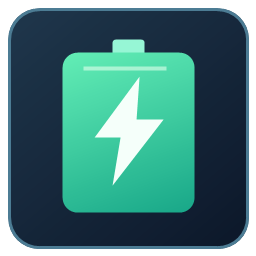

# Eaton UPS Monitor

Italiano · [English](README.md)



Una piccola utility Windows non ufficiale per leggere i dati di un UPS Eaton via USB e controllarne il cicalino. Italiano e inglese sono inclusi nella stessa applicazione. È un progetto indipendente della comunità, senza affiliazione con Eaton.

## Hardware supportato

**L’unico modello testato e attualmente supportato è Eaton 5E1600UD (5E 1600 G2), firmware 01.02.0009.** Le prove sono state eseguite con USB VID `0463`, PID `FFFF`, driver WinUSB Eaton e Windows x64. Questi identificativi USB sono condivisi da altri dispositivi e da soli non garantiscono la compatibilità.

Altri modelli e firmware sono **non verificati**. Chi vuole può provarli e [aprire una segnalazione di compatibilità](../../issues/new?template=compatibility.yml), anche in italiano. Una segnalazione non aggiunge automaticamente il dispositivo ai modelli supportati. L’app cerca solo questo identificativo USB e richiede un unico UPS corrispondente; non permette di scegliere tra più unità.

## Funzioni

- Percentuale batteria, autonomia stimata dall’UPS, carico, potenza attiva/apparente, tensioni, frequenza e stati disponibili.
- Disabilitazione e riabilitazione del cicalino, oppure silenziamento temporaneo dell’allarme attuale.
- Overlay in caso di blackout e ripristino della rete; la perdita USB viene segnalata separatamente.
- Chiudere o minimizzare la finestra mantiene l’app nella barra dell’orologio. **Esci completamente** la termina.
- Installazione facoltativa per l’utente, collegamento desktop e avvio all’accesso a Windows nella barra dell’orologio.
- Lingua da **Impostazioni → Lingua / Language**. Esci completamente e riapri per applicare la scelta. Al primo avvio segue Windows: italiano per Windows italiano, inglese negli altri casi.

**Non esegue lo spegnimento automatico del PC.** Non sostituisce le regole di arresto di Companion o un sistema completo di protezione UPS. Letture e overlay richiedono app aperta e USB collegata. Questa app Windows non supporta Raspberry Pi né ponti di rete/Bluetooth.

## Scarica e avvia

1. Scarica `EatonMonitor-3.1.0-windows-x64.zip` dalle [Release](../../releases).
2. Estrai lo ZIP e avvia `EatonMonitor.exe` su Windows x64 con .NET Framework 4.8.
3. Collega l’UPS via USB e chiudi completamente Eaton UPS Companion per evitare accessi concorrenti. Il driver WinUSB originale Eaton deve essere già installato.
4. Puoi usarla portatile. Per installarla, vai in **Impostazioni → Installa per questo utente**, quindi attiva facoltativamente **Avvia con Windows**. Si installa in `%LOCALAPPDATA%\EatonMonitor`; l’uso normale non richiede amministratore. L’eseguibile non ha firma digitale.

Opzioni da terminale:

```powershell
.\EatonMonitor.exe --lang en
.\EatonMonitor.exe --lang it
.\EatonMonitor.exe --tray
.\EatonMonitor.exe --setup
.\EatonMonitor.exe --uninstall
```

`--lang` cambia lingua solo per quel processo, senza modificare la preferenza salvata. Se l’app è già aperta, esci completamente prima di cambiare le opzioni. Puoi disinstallarla anche dalle App installate di Windows: il driver USB resta installato.

## Cicalino e prove eseguite

Il silenziamento temporaneo è stato confermato acusticamente sul modello provato durante una reale mancanza di corrente. Disabilitazione e riabilitazione sono state confermate anche rileggendo lo stato USB. L’unica scrittura è il comando HID `AudibleAlarmControl`, report `0x14`, con struttura verificata separatamente e valori `1` (disabilita), `2` (abilita), `3` (silenzia temporaneamente). L’app non invia comandi di spegnimento UPS, controllo prese o firmware.

La persistenza dopo scollegamento USB, riaccensione dell’UPS o nuove condizioni di allarme **non è stata verificata**. La conferma USB non garantisce che ogni allarme futuro resti silenzioso. Non occorre modificare il firmware e l’app non lo supporta.

L’anteprima overlay è soltanto visiva e non invia comandi al cicalino. I test automatici simulano i cambi di alimentazione su pacchetti offline; non riproducono un blackout reale e non verificano il suono.

## Driver USB e rimozione di Companion

Codice e release **non contengono driver Eaton né file di Companion**. Prima di rimuovere Companion conserva il driver ufficiale originale: la sua disinstallazione può eliminare il driver USB necessario a questa app.

Da terminale Windows come amministratore, usa `pnputil /enum-drivers` per identificare il nome pubblicato del driver UPS Eaton, per esempio `oem42.inf` (sostituiscilo con quello effettivo). Crea una cartella ed esporta il pacchetto:

```powershell
New-Item -ItemType Directory -Force "$env:USERPROFILE\Documents\EatonDriverBackup"
pnputil /export-driver oem42.inf "$env:USERPROFILE\Documents\EatonDriverBackup"
```

Conserva tutto il pacchetto esportato, incluso il catalogo. Se il driver viene rimosso, scegli **Impostazioni → Ripristina driver USB Eaton…** e seleziona il file INF originale esportato, oppure reinstalla il driver tramite l’installer ufficiale Eaton. Windows chiede l’autorizzazione di amministratore soltanto per installare il driver. Il pulsante esegue `pnputil /add-driver "file-selezionato.inf" /install`, senza scaricare o modificare driver.

## Compilazione e test

Non occorrono librerie esterne o download di pacchetti. Da PowerShell Windows x64 con .NET Framework 4.8:

```powershell
.\build.ps1 -Test
```

Risultati in `dist/EatonMonitor.exe` e nello ZIP della release. La compilazione usa il compilatore C# di .NET Framework. I test offline verificano decodifica HID, scale delle misure, stati dinamici, input malformati, validazione del report cicalino, traduzioni e risorse dell’installer. Non richiedono un UPS e non inviano comandi hardware. Anche GitHub Actions compila ed esegue i test.

Le fixture includono la struttura dei report USB del modello provato e alcuni pacchetti di misure, senza numeri di serie né tabelle di stringhe USB. Gli eventi della sessione rimangono in memoria; preferenze, installazione e avvio automatico sono nel registro dell’utente corrente. L’app non invia dati in rete e non ha un servizio di telemetria remoto.

## Contributi e licenza

Vedi [CONTRIBUTING.md](CONTRIBUTING.md) per le segnalazioni, accettate anche in italiano. Non caricare numeri di serie, percorsi privati dei dispositivi, binari del produttore o firmware proprietari. Distingui tra conferma USB, comportamento sonoro e persistenza.

Codice e icona del progetto sono disponibili con [licenza MIT](LICENSE). Eaton è un marchio del rispettivo proprietario; non è implicata alcuna affiliazione o approvazione.
